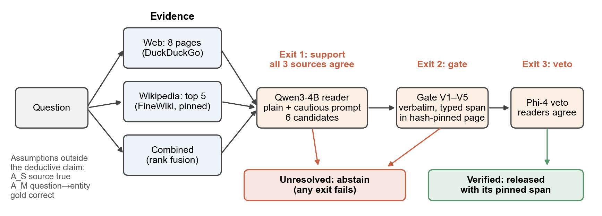
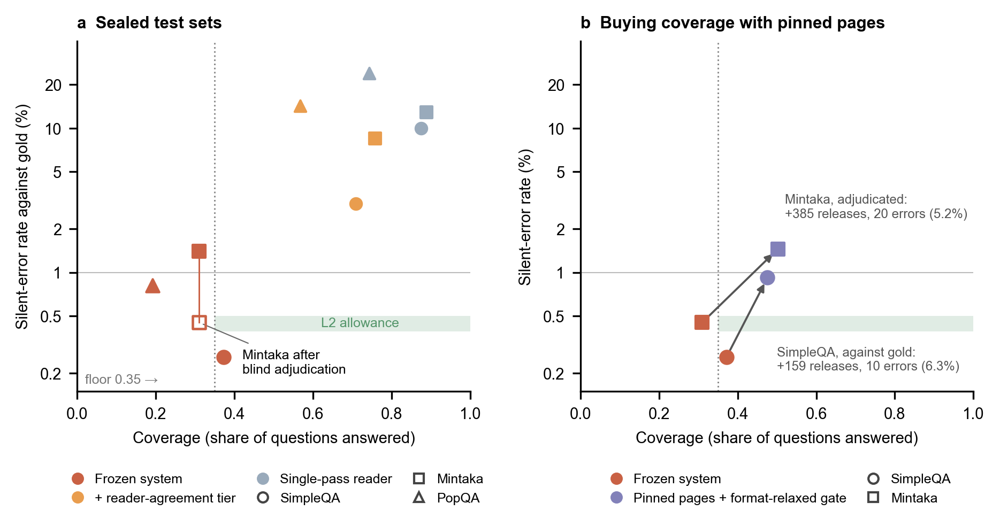
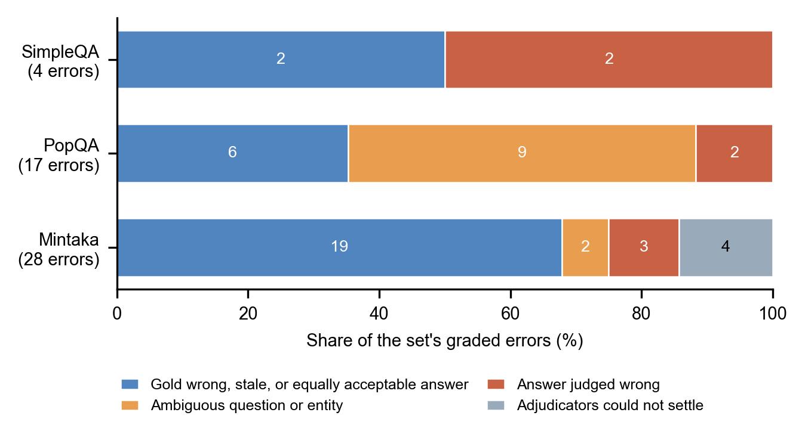

# Quote or Quiet: Small Local Models That Answer With a Quote, or Not at All

<!-- DRAFT v0.3, 2026-11-10: adds Sections 5.10 and 5.11 (S42; numbers trace to docs/S42_CLAIM_AUDIT_AND_PLAN.md section 6 and docs/S41_RESULT.md) and the quote-sufficiency related work; its 12 added references were checked against their arXiv pages on 2026-11-10. DRAFT v0.2, 2026-11-09. Rewritten around claims the evidence supports. All references were matched to their publisher or arXiv
records on 2026-11-09; claim support is logged in docs/CLAIM_SOURCE_LOG.md (23 pairings checked). Numbers trace to results/runs/s19/S19_RESULT.md, results/runs/s21/S21_RESULT.md, docs/S22_DEV_FINDINGS.md,
docs/L3_CERTIFICATES.md and results/runs/s22/mintaka_test_adj_result_strict.md. -->

## Abstract

A language model that answers a factual question wrongly and without qualification commits a silent error. We ask whether a small local system can keep its silent-error rate (SER, wrong answers over all questions) below 1% with statistical confidence while still answering a fixed share of questions. The system releases an answer only when three evidence sources agree, the answer is a verbatim, typed span of a hash-pinned page, and a second reader concurs; otherwise it abstains. On 1,526 sealed SimpleQA questions, run once under a pre-registered protocol, it answered 37.2% with 4 graded errors, a one-sided 97.5% upper bound on SER of 0.76% after correcting for grader false credit. The same frozen system missed the 35% coverage floor on Mintaka (31.0%) and PopQA (19.1%). On Mintaka, blind adjudication validated with decoys showed that 19 of its 28 errors were stale or wrong gold, or equally acceptable answers; the remaining 9 give an SER of 0.45% (upper bound 0.92%), so coverage, not precision, stops the transfer. On a second sealed set of 3,359 questions generated from Wikidata with current gold, run once under a new pre-registration, the system answered 52.5%; after the same adjudication 18 errors remained, an upper bound of 0.88%, and blind review against the facts found 1 wrong release in 1,765. There it had lower silent error than the raw model, the raw model told to abstain, standard RAG and RAG told to abstain, and was non-inferior to an agreement baseline at equal coverage; releasing two-source answers that the gate and the second reader accept, a rule registered beforehand, added 4.3 points of coverage with 3 wrong answers in 144. Raising coverage cost precision: pinned pages and relaxed answer formats added answers at 5 to 6% error, title-based retrieval at 6.5%, and neither a larger veto nor a small trained checker caught them. At equal coverage the system made 4 errors against 9 for an agreement baseline on SimpleQA (not significant) and as many on the other two sets. On synthetic closed-evidence sets with exact gold (two sealed sets, two assignments of models to roles), the same machinery gave no wrong definite answer (upper bound 0.25%). A quote that exists on its page need not state the answer: in blind review the quote shown by the frozen rule did not state it in 12.5% of Verified releases, almost all with right answers. Choosing, among the accepted spans, the first that passes a frame check, a subject link and a quote-only reader reduced this to 2 of 1,017 fresh releases (0.20%, upper bound 0.71%) for a coverage cost of about 3.5 points. For names that several films or people share, answering once per reading, each with its own quote, gave no false answer and no misleading quote in 250 readings (upper bound 1.5%). For biographies written by a 4B model the same check kept 20% of the claims of closed-book drafts with 4.7% false, and, when the draft was written from the subject's own page, 61% of the claims of fifty fresh subjects with 1 false and 1 misleading quote in a blind sample of 400. The deductive check behaves as designed; the limits are coverage, source independence and benchmark gold.

## 1. Introduction

Large language models answer factual questions fluently whether or not they know the answer. For a user, the costly case is the silent error: a definite, unqualified answer that is wrong. Abstention avoids it, but a system that abstains on everything is useless, so a claim about silent errors needs two numbers. SER is the number of wrong definite answers divided by all questions, and coverage is the share of questions answered. Since SER equals coverage times the error rate among answered questions (selective risk), a bound on SER means something only together with a coverage floor.

We pursued three levels of evidence. An empirical reduction of SER against a strong baseline at equal coverage (L1) is the common standard. A statistical guarantee (L2) asks for more: on a stated task distribution, the one-sided upper confidence bound on SER must fall below 1% while coverage stays above a pre-specified floor, on enough independent items for the bound to be informative. A deductive guarantee (L3) asks that every released claim provably satisfies a stated verification condition, given explicit assumptions.

This paper reports an L2 result on two sealed benchmarks and measures what limits it on two others. Our contributions are:

1. A pipeline that combines cross-source agreement, a deductive span gate and a second-reader veto, with every released answer tied to a verbatim span of a hash-pinned document.
2. A pre-registered, single-run evaluation on 1,526 sealed SimpleQA questions in which the one-sided 97.5% upper bound on SER is 0.76% at 37.2% coverage.
3. A pre-registered transfer test on Mintaka and PopQA in which the coverage floor is missed, and a blind, decoy-validated adjudication that separates system errors from benchmark gold errors on Mintaka.
4. Measurements of what raising coverage costs (pinned pages, title-based retrieval, a larger veto), a comparison with an agreement baseline and with a Learn-then-Test threshold at equal coverage, and a derivation-certificate extension for computed answers that adds almost nothing.
5. A second pre-registered, single-run evaluation on 3,359 sealed Wikidata questions with current gold, in which the bound is 0.88% at 52.5% coverage, the system beats four standard baselines and is non-inferior to an agreement baseline, and a two-source release rule registered beforehand raises coverage to 56.8% at 3 real errors in 144 added answers.
6. A synthetic closed-evidence benchmark with exact gold, on which the same machinery, including entity lists and certified computations, gave no wrong definite answer in two sealed sets under two assignments of models to roles.

## 2. Related work

Selective prediction trades coverage for risk by rejecting instances until a user-set risk level is met [@geifman2017selective]; conformal risk control controls the expected value of a monotone loss [@angelopoulos2024crc], and Learn-then-Test calibrates predictors with finite-sample statistical guarantees [@angelopoulos2021ltt]. These are statistical guarantees, the L2 level, and they inherit the quality of the score being thresholded. Our gate instead makes a deductive statement about each released answer and leaves the statistics to the evaluation.

Risk-controlled abstention has recently reached retrieval-augmented question answering. BalanceRAG calibrates a pair of thresholds, one for an LLM-only branch and one for a retrieval fallback, so that the error rate among accepted answers stays at a target level [@jia2026balancerag], and a judge that routes uncertain verdicts to web evidence keeps the false discovery rate of accepted verdicts below a chosen level with Clopper-Pearson intervals [@badshah2026judge]. Both certify a calibrated confidence score at risk targets of 10 to 16% (BalanceRAG) and 5 to 30% (judge), validated on random splits of the same benchmark with gold matched by semantic similarity or reference labels; BalanceRAG states that its guarantee assumes calibration and deployment data share a distribution. These methods bound the error among accepted answers (selective risk), whereas we bound the error over all questions; on FRESH-5 our corrected 97.5% upper bound is 0.76% of all questions and 2.04% of released answers. We certify a frozen system whose releases pass a deductive gate on held-out questions, test transfer to other benchmarks, and audit the gold. Conformal factuality is fragile for retrieval-augmented models: it produces vacuous outputs at high factuality levels and does not survive distribution shift or distractors [@chen2026conformalrag], which is the pattern of our transfer to Mintaka and PopQA. Extractive systems avoid generated text by mapping queries to verbatim spans [@recski2026aclverbatim], and proof-carrying numbers mark LLM-emitted numbers as verified only after a verifier checks them against structured claims [@solatorio2025pcn]. We add typed span checks against hash-pinned pages, a statistical bound, and measured failure modes. Agreement across models is a weak signal when their errors are correlated [@denisov2026consensus], which is consistent with our finding that reader agreement filters as well as the gate on two of three sets.

Attribution and citation work asks whether generated text is supported by a source [@rashkin2023ais; @gao2023alce]; retrieval-augmented and self-reflective generation improve factuality and citation accuracy [@asai2024selfrag]. Uncertainty methods detect likely confabulations from sampling disagreement [@manakul2023selfcheckgpt; @farquhar2024semantic]. We use agreement too, but across evidence sources rather than samples, and we add a verbatim-span requirement.

A correct answer can sit beside a quote that does not state it. In weakly supervised reading comprehension an answer string can occur several times in a document with only one occurrence answering the question [@min2019hardem], and in a manual check of 20 Natural Questions items 30% of the passages that contained the answer string gave no evidence for it [@asai2022evidentiality]. People found 51.5% of the sentences of generative search engines fully supported by their citations and 74.5% of citations supporting their sentence [@liu2023verifiability]. In clinical question answering a verbatim quote can be attached to nearly every claim and still not support it: for one model 98.0% of claims carried a verbatim quote and 37.1% were fully substantiated [@zhang2026verifiable]. GopherCite answers with a verbatim quote and abstains when unsure [@menick2022verified], and claim-anchored provenance drops claims for which no quote can be located, while leaving support to the model [@guan2026cams]. A layered oversight system for enterprise use combines groundedness scoring, checks of extractions against the source text and calibrated abstention [@raduta2026halo]; its abstract gives no rate of quotes that fail to support the answer. Sufficiency of the evidence has been used as a release signal at passage level, with a trained or large rater [@joren2025sufficient; @qiu2026sure]. Evidence chosen to convince a reader model also sways it towards wrong answers [@perez2019convince], which is why our witness rule (Section 5.11) pairs the reader with lexical checks. We did not find a training-free rule that chooses among all the spans a deductive gate accepts, withholds the answer when none passes, and is tested by blind review of fresh items against a bound near 1% (searched 10 November 2026; the search cannot show that none exists).

SimpleQA [@wei2024simpleqa] measures short-form factuality with questions written to have a single, stable answer. Mintaka [@sen2022mintaka] collects questions naturally elicited from crowd workers and annotated with Wikidata entities. PopQA [@mallen2023popqa] templates questions from Wikidata triples over entities of varying popularity. The three differ in the properties our assumptions touch: entity ambiguity, answer stability over time, and gold provenance. Benchmark noise is known: SimpleQA Verified filtered and re-verified the original after finding incorrect labels, topical bias and redundant questions [@haas2025simpleqaverified], PAT-Questions regenerates its gold answers from knowledge-graph queries so that they stay current [@meem2024pat], and AmbigDocs studies questions about entities that share a name [@lee2024ambigdocs]. Jiang et al. find that 24% to 64% of the time-sensitive samples in five common factuality benchmarks are outdated against July 2025 facts [@jiang2026benchmarksage]. We measure how much of the error on Mintaka and PopQA comes from stale gold and shared names.

## 3. System

**Evidence.** For each question the pipeline gathers three passages: up to eight web pages returned by a DuckDuckGo search on the question alone, with pages that quote the benchmark question removed; the five highest-ranked articles from a local copy of English Wikipedia (FineWiki, August 2025) under a hybrid lexical and dense retriever; and a combined passage that ranks chunks of both by reciprocal-rank fusion.

**Readers.** Qwen3-4B-Instruct-2507, the updated non-thinking release of the Qwen3 family [@qwen3; @qwen3card], answers from each passage under a plain and a cautious prompt (the cautious prompt permits "unknown"), giving six candidate answers. The candidate supported by the most sources is selected; release requires support from all three sources.

**Deductive gate.** The selected answer must appear verbatim in one of the pinned Wikipedia articles, and the span must pass five checks: the document is in the corpus with the recorded hash (V1); the released string is that span (V2); the span matches the answer type the question asks for, including whole numbers and year-month granularity (V3); a year in the article title agrees with the question (V4); and a counted unit matches the counted noun (V5).

**Veto.** Phi-4 [@abdin2024phi4] answers the combined passage under the cautious prompt; the answer is released only if the two readers agree after normalisation.

**Figure 1. A released answer is a verbatim span in a hash-pinned page that three evidence sources and a second reader support.** Three passages (web, local Wikipedia top five, and a rank-fusion combination of both) are read by Qwen3-4B under a plain and a cautious prompt. Release requires, in order, support from all three sources (exit 1), a span that passes checks V1 to V5 (exit 2) and agreement from the Phi-4 veto reader (exit 3). Failing any exit gives Unresolved. The deductive claim covers the span; the three assumptions listed at lower left lie outside it.

An answer that clears all three exits is Verified. Every other question is Unresolved. The system makes one claim per released answer, and that claim is deductive: the released string equals a span of a hash-pinned document accepted by V1 to V5. Whether that span is true, and whether it answers the question that was meant, rests on three assumptions outside the proof: the source is correct (A_S), the question was mapped to the right entity and relation (A_M), and the benchmark gold is correct. A released answer is shown together with its quoted span and the title of the page that holds it (for example "Michael Mann; quote from Heat (1995 film)"). When the page is about the question's subject, the mapping assumption A_M becomes visible: if several things share the name, the title states which one the answer is about, and a reader who meant another one can see the mismatch without searching. When the answer comes from another page (a list, an outline, the answer's own article), the title does not show the reading.

## 4. Evaluation protocol

**Test sets.** FRESH-5 contains all 1,526 original SimpleQA questions that remained after removing SimpleQA Verified [@haas2025simpleqaverified] and earlier test pools. For the transfer test we drew 2,000 Mintaka questions of the "generic" type and 2,100 PopQA questions, 700 from each popularity tercile, after setting aside design sets of 200 and 300. Test files were sealed with recorded hashes before any system design that could use them, and each was evaluated once.

**Grading.** An LLM judge (Qwen3.8-27B under a fixed prompt) graded each answer. Its false-credit rate was measured on blind human labels: 1 of 677 truly wrong answers was credited, a one-sided 97.5% upper bound of f = 0.82%. For Mintaka and PopQA, which list several acceptable answers, an answer counts as correct if the judge accepts it against any of up to nine gold aliases; for single-gold items this rule equals the original grader. The judge comes from the same model family as the readers (Qwen3), so its credit decisions are checked against labels from outside the family: the blind human labels above, and independent adjudication agents with web access, which flagged 62 of 62 injected false answers and agreed with the gold on 61 of 63 correct releases.

**Decision rule.** With k graded-wrong releases among n questions, we inflate the error count to E = ⌈k / (1 − f)⌉ to cover wrong answers the judge may have credited, and declare L2 met if the Clopper-Pearson [@clopper1934] one-sided 97.5% upper bound on E/n is below 1% and coverage is at least 35%. This allows k ≤ 6 at n = 1,526 and k ≤ 10 at n = 2,000.

**Pre-registration.** Before each test we fixed the code, models, prompts, decision rule and predictions with prior probabilities, and recorded file hashes, which were checked again after the run. Sections 5.1 and 5.2 report these pre-registered endpoints. Sections 5.3 to 5.6 are post hoc analyses on test sets that had already been unsealed, which therefore served as design data; they are descriptive. Section 5.7 followed its own protocol: code frozen with hashes, predictions with prior probabilities, a new sealed set for each configuration, one run each.

**Blind adjudication.** To separate system errors from benchmark errors on Mintaka we built a sheet of 251 rows, each showing only a question, the gold answer and one answer: 63 system errors, 63 wrong answers from the single-pass reader on unreleased questions, 63 correct system answers, and 62 injected-false answers (the answer replaced by another item's gold of the same type). The 28 errors of the frozen system are a subset of the 63. Two adjudicators worked independently, each as four fresh language-model agents with web search and no access to the pipeline, choosing among: gold wrong, answer wrong, both acceptable, matches gold, ambiguous question, and cannot tell. An error is removed only when both adjudicators judge gold wrong, both acceptable or matches gold and each supplies a quote that occurs verbatim in the page it cites; every other verdict keeps it. The adjudication is valid only if at least 95% of injected-false answers are called wrong. The reference date was 8 November 2026.

**Deviations.** In the FRESH-5 run one query received a search-engine error page twice and was recorded as having no web results, and the run was restarted from cached stages after out-of-memory failures. In the transfer run one 201,455-character web passage exceeded the reader's memory cap, which was raised from 0.65 to 0.88 of GPU memory before resuming.

## 5. Results

### 5.1 The bound holds on sealed SimpleQA questions

On FRESH-5 the system released 568 answers (coverage 37.2%) with k = 4 graded errors, a raw SER of 0.26% and a corrected upper bound of 0.76%, which meets the pre-registered L2 criterion (Table 1). The single-pass reader on the combined passage answered 87.5% of questions with an SER of 10.0%. Selective risk among released answers was 0.7%.

All four errors are stated on their pinned pages. Two are disagreements between source and gold (an exhibition year and a date of death, each one unit apart), one gives an incomplete name where the full name was asked, and one ignores an "as of 2022" qualifier. None is an answer the reader made up.

**Table 1.** Frozen system on the three sealed test sets (gold-relative, alias-aware grading).

| set | n | coverage | k | SER | upper bound (97.5%, corrected) | L2 | single-pass reader coverage / SER |
|---|---|---|---|---|---|---|---|
| FRESH-5 (SimpleQA) | 1,526 | 0.372 | 4 | 0.26% | 0.76% | met | 0.875 / 10.0% |
| Mintaka | 2,000 | 0.310 | 28 | 1.40% | 2.08% | not met | 0.888 / 12.9% |
| PopQA | 2,100 | 0.191 | 17 | 0.81% | 1.35% | descriptive | 0.743 / 24.1% |

### 5.2 Coverage does not transfer

On Mintaka the system answered 31.0% of questions, below the 35% floor, with 28 graded errors (SER 1.40%, upper bound 2.08%), so L2 was not met on either condition. This matched the pre-registered expectation (prior probability of meeting L2, about 12%). Coverage ranged from 0.25 on history and politics questions to 0.41 on books and video games. On PopQA the system answered 19.1% (SER 0.81%); coverage was highest for the least popular tercile (0.25, against 0.17 for the most popular), contrary to our prediction.

Per question, the system's SER was about 9 times (Mintaka) and 30 times (PopQA) lower than that of the single-pass reader, but the reader answered three to four times as many questions (Fig. 2a). Per released answer, selective risk against the gold was 4.5% on Mintaka and 4.2% on PopQA, compared with 0.7% on FRESH-5.

An extension that also released answers on which the two readers agreed answered more and erred more: 75.8% coverage with 8.5% SER on Mintaka and 56.7% with 14.3% on PopQA. Its second tier contributed 142 of its 170 Mintaka errors. Reader agreement, which had worked on SimpleQA (3.0% SER at 70.9% coverage), did not carry over.

**Figure 2. Only the frozen system on SimpleQA reaches the L2 region, and adding coverage moves points out of it.** **a**, Coverage and silent-error rate against the gold on the three sealed test sets for the frozen system, an extension that also releases answers on which the two readers agree, and the single-pass reader on the combined passage. The open square marks the frozen system on Mintaka after blind adjudication (9 of 28 errors kept, Section 5.3). **b**, Frozen system and the variant with pinned pages and a format-relaxed gate on SimpleQA (FRESH-5, errors against the gold) and Mintaka (errors after strict adjudication). Added releases and their errors are given beside each arrow. In both panels the dotted line marks the 35% coverage floor and the shaded band the raw error rates allowed by the L2 rule at 35% coverage or more (0.39% at n = 1,526, 0.50% at n = 2,000); the error axis is logarithmic.

### 5.3 On Mintaka most graded errors are not the system's

Blind adjudication removed 19 of the 28 Mintaka errors: 16 had wrong or stale gold and 3 had a second answer that is equally acceptable. The remaining 9 are 3 answers judged wrong, 2 ambiguous questions and 4 that the adjudicators could not settle. Taking all 9 as errors, SER is 0.45% and the corrected upper bound is 0.92%, below 1% (Table 2).

The removed errors are mostly questions about the present asked in 2021: "Who is the current president of Kenya?", the governor of Arkansas, career totals that have since changed. The gold was correct when written and the 2025 snapshot is correct now. Both adjudicators called all 62 injected-false answers wrong and recognised 61 of the 63 correct system answers as matching the gold. The single-pass reader's wrong answers were removed less often (20 of 63, 32%, against 54% of the system's), which suggests that gold errors concentrate where several sources agree on a current fact.

**Table 2.** Mintaka test, frozen system, before and after blind adjudication (post hoc).

| | errors | SER | upper bound (97.5%, corrected) | coverage |
|---|---|---|---|---|
| against the gold | 28 | 1.40% | 2.08% | 0.310 |
| after adjudication | 9 | 0.45% | 0.92% | 0.310 |

Precision on Mintaka is therefore compatible with the 1% bound; coverage is not (Fig. 2a, open square). The corrected count depends on the adjudication rule. Of the 63 errors of the combination system in Section 5.4, a single adjudicator under a looser rubric removed 54, while two adjudicators under the stricter rubric, both required to agree, removed 34. We report the strict rule.

The composition of the errors differs by benchmark (Fig. 3). On PopQA, which we read but did not adjudicate, 8 of the 17 errors were ambiguous subjects: the template names an entity by a label that several entities share, such as a town called Lima in the United States whose country the gold gives, while the system answered for the Peruvian capital. Six were gold that lists one acceptable answer among several (occupations, a district versus its city), one was an ill-posed template, and two were plausible errors by the system.

**Figure 3. Gold and ambiguity account for most graded errors on Mintaka and PopQA, and half of those on SimpleQA.** Composition of the frozen system's errors against the gold on each sealed set. Mintaka classes come from the strict blind adjudication (n = 28). SimpleQA (n = 4) and PopQA (n = 17) classes come from the authors' reading of each error against its pinned page. For these two sets the ill-posed PopQA template is counted with ambiguous questions, the source-versus-gold disagreements on SimpleQA with gold errors, and the incomplete name and the ignored "as of 2022" qualifier with answers judged wrong.

### 5.4 Raising coverage: most variants cost precision, one did not

On the Mintaka design set, the largest group of abstentions (85 of 200 questions) were candidates supported by two sources rather than three. These are effectively single-source: in 70 of the 85 the agreeing readers were the web and combined passages, and the combined passage contains the web pages. Admitting them through the same gate and veto added 19 releases of which 8 were wrong. In 69 of the 85, the web results already named an English Wikipedia article that exists in the local snapshot but was not among the five articles the local retriever returned. Answer-format losses at the gate (full-sentence answers, date formats) accounted for a further 12% of the design set, all with correct candidates.

Two changes address these losses. Pinning places the web-named Wikipedia articles first in the wiki evidence, and a format-relaxed gate tries every agreeing surface form, longest first, with era years and full dates accepted for "when" questions. Claims stay verbatim and typed. A time-sensitivity rule keeps questions about incumbents, "current" or "latest" records, and all-time records out of the Verified state, and a subject-ambiguity rule withholds answers whose question names an entity with several pages. Applied to the Mintaka test set, the combination of the original releases and the pinned releases that pass both rules reached coverage 0.502 (1,005 of 2,000), against 0.310.

The added answers were less reliable (Table 3, Fig. 2b). On Mintaka, 385 releases were added and 20 more errors survived strict adjudication, 5.2%; the frozen part contributed 9 of 620, 1.5%. On FRESH-5 the same pipeline added 159 releases and 10 errors against the gold (6.3%); eight of the errors were among the 126 pinned releases, and they were real: Callisto given for Jupiter's third-largest moon, 1886 given for 1868, a wrong high school. On a benchmark with clean gold the added precision is poor because a pinned page is often the page the web reader had already seen, so a third supporting source is no longer independent. The variant would have failed L2 on FRESH-5 (14 errors against an allowance of 6), so it was not run on sealed data.

A retrieval path that finds the pages without web results keeps the sources independent. It matches the question's entity mentions against the Wikipedia title index and re-ranks the BM25 results by title overlap with the question. On the Mintaka and PopQA design sets, where both variants ran, pinning added 53 releases with 11 errors (21%) and title-based retrieval added 31 with 2 (6.5%); on SimpleQA design data it added 18 with 1. The relaxed format gate added a further 24 releases with 2 errors. Pooled over the three design sets the 73 added releases had 5 errors (6.8%), above the 3% we had set as the condition for running the variant on FRESH-5, so we did not. Replacing the Phi-4 veto with Qwen3.8-27B did not help: over the pinned and title-based variants the wrong added releases were 18 with Phi-4, 18 with the larger model and 16 when both had to agree, while the correct added releases stayed at 122, 133 and 121, so the added errors are ones that every reader reads the same way. Requiring the answer to occur verbatim on a second retrieved page did not separate them either (6 of 48 corroborated added releases were wrong, 12 of 92 uncorroborated). A small model trained to judge whether the sentence containing the span states the answer to the question reached an AUROC of 0.99 on held-out training-style examples but 0.57 to 0.68 on the system's real releases; at a threshold that kept 95% of the correct releases it flagged 15 of 95 wrong ones (16%), and 4 of the 8 clearest relation errors.

**Table 3.** Cost of the coverage gain (post hoc; errors after strict adjudication on Mintaka, against the gold on FRESH-5).

| set | frozen system: releases / errors | pinned + format gate: releases / errors | added releases / added errors | error rate of added releases |
|---|---|---|---|---|
| Mintaka test | 620 / 9 | 1,005 / 29 | 385 / 20 | 5.2% |
| FRESH-5 | 568 / 4 | 727 / 14 | 159 / 10 | 6.3% |

We also tried to find, without gold, the questions behind the remaining errors, each time with a pass rule fixed before the test (at least 20 added or withheld answers, and at most 3% wrong among added answers or at least 20% wrong among withheld ones). Accepting spans from the question's own web pages in addition to the pinned Wikipedia page added 24 releases on the design sets with 2 errors (8.3%), both questions whose title several works share. Within the two-source pool, which holds 42% of design questions with a candidate that is right 72% of the time, the best combination of deterministic features (second reader agrees, gate passes, Wikipedia reader abstained) held out at 23 added releases with 2 errors (8.7%). A detector of same-name subjects built from the title index withheld 104 of 1,589 test releases, of which 12 were wrong (11.5%) and 92 right. Asking Phi-4 which page a question means did not separate ambiguous from clear questions (6% wrong among those it called ambiguous). All four failed their rules.

These rules counted errors against the gold, and Section 5.8 shows that on Mintaka and PopQA most gold-relative errors are benchmark errors. We therefore had every release added by the rejected variants on the design sets checked against the facts by two blind reviewers (question and answer only; 20 injected false answers, all caught), with a new rule fixed beforehand: at least 40 added releases, at most 3% wrong, and a one-sided 90% upper bound of at most 6%. The two-source cell passed: 55 added releases, none wrong against the facts (upper bound 4.1%); its four gold-relative errors were questions with two valid readings. Title-based retrieval added 72 releases with 2 real errors (2.8%; upper bound 7.2%), inconclusive at this size. Pinning added 67 with 5 real errors (7.5%), all PopQA titles shared by several works. The cell rule needs no new generation, so it was registered as a secondary test on the second sealed set before that set was scored (Section 5.9). A further 1,200 design questions (PopQA and Mintaka, not used before) were then run with both rules and reviewed the same way under a stricter rule (at least 60 added, at most 3% wrong, upper bound at most 5%; 20 of 20 decoys caught, 0 of 30 random frozen releases called wrong): title-based retrieval added 124 releases with none wrong against the facts (upper bound 1.8%), although 19 disagreed with the gold, and passed; the cell added only 30, one of them wrong, too few to decide on this set.

At 50% coverage on 2,000 Mintaka questions, 29 surviving errors (SER 1.45%) exceed the allowance of 10. Of the 29, about 9 are answers we judge wrong, about 9 are ambiguous questions, and about 11 are cases where the two adjudicators disagreed or one could not verify the answer (the authors' reading).

### 5.5 Against an agreement baseline at equal coverage

We asked whether the pipeline produces fewer errors than a strong baseline spending the same compute. The baseline ranks the single-pass reader's answers by how many of the system's reader outputs (six from the 4B model, one from Phi-4) agree with them, and answers the top-ranked share that matches the system's coverage. At equal coverage the system's errors against the gold were 4 against 9 on FRESH-5 (ratio 0.44), 28 against 26 on Mintaka (1.08) and 17 against 19 on PopQA (0.89). The FRESH-5 ratio is a point estimate, not a significant difference (exact binomial test on the 13 errors, one-sided p = 0.13), and on the other two sets the gate and veto do about as well as agreement alone. The contribution of the gate is therefore the certificate, a verbatim span in a pinned page, and not fewer errors than agreement at equal coverage.

Errors against the gold understate any difference, because most of them are benchmark errors that hit both rules alike (Section 5.8). We therefore reviewed every gold-wrong release of either rule on the three test sets, blind to the rule and to the gold, with the baseline matched to exactly the system's coverage (all releases above its threshold score plus a proportional share of those at it; expected counts). Answers judged wrong by both reviewers numbered 3 for the system and 8.0 for the baseline (0 against 4.6 on FRESH-5, 1 against 1.3 on Mintaka, 2 against 2.2 on PopQA). All three system errors were also baseline errors. Most of the baseline's extra errors on FRESH-5 were incomplete answers (a year where the question asks for a month and year, a month where it asks for a date), which the gate's type check refuses. Only 9 errors were made by one rule and not the other, so the 63% lower point estimate is not significant (one-sided binomial test of "system errors at least half the baseline's", p = 0.38). With error rates near 0.2% of questions, showing a 50% reduction with 80% power at this ratio would need about 86 such errors, or roughly 55,000 questions. We report the original criterion (at least 50% fewer silent errors than a strong baseline at equal coverage) as not established, and test a revised criterion, fixed before the second sealed set was scored: lower silent error than the raw model, the raw model told to abstain, standard RAG and RAG told to abstain, and non-inferiority to the agreement ablation (difference in silent error below 0.25 points, difference in correct-answer yield above -1 point, one-sided 95% bounds). On the three test sets already used, the non-inferiority bounds are +0.00 and -0.48 points; this is reported for reference only.

A calibrated selective baseline gives the same picture on SimpleQA. We selected a threshold on the same agreement score with Learn-then-Test [@angelopoulos2021ltt]: fixed-sequence testing from the strictest threshold, with H0 "SER at least 1%" rejected at 2.5% on 2,500 SimpleQA design items (dev, fresh and the two S18 pools) and the same false-credit correction. Only the strictest threshold passed; it keeps answers on which all six other reader outputs agree (880 released, 7 errors on the calibration items). On FRESH-5 it answered 552 questions (36.2%) with 9 errors (SER 0.59%, corrected upper bound 1.20%), against 568 answers and 4 errors for the system. The baseline's observed SER is below 1%, but its error count is higher than the calibration predicted (0.28% of questions), and the pre-declared rule is not met.

### 5.6 Derived answers add almost nothing

Some answers are not a span of any page but a computation over spans, such as an age from a birth year and a reference date. We built derivation certificates for these: each fact is a quote that must occur verbatim in a pinned page, values are parsed from the quotes by deterministic code, and the answer is the output of a fixed operation (age at a date, years between, difference, sum). A language model proposes the quotes and the operation and never supplies a value. On the Mintaka test set, 224 questions were numerical-answer candidates; 12 received a certificate, 4 were correct and only one of those (Einstein's age at death) had not already been released. The 8 wrong certificates were 6 present-tense "how old is X" questions whose gold was written in 2021, and 2 correct computations on the wrong quantity (an NFL roster size and a count for the Lincoln Memorial). The verbatim check worked: in a first run with web snippets as evidence, all 61 specifications that quoted text absent from the pinned page were rejected. Of the 2,000 questions, 27 (1.4%) are stable computations whose answer is not already on the pinned page, so the ceiling of the approach on this benchmark is low.

### 5.7 With exact gold, the deductive machinery gave no wrong answer

In this section an answer is Verified when it is a verbatim span, Derived when it is the output of a certified computation, and Qualified when it is a list with one answer per candidate entity; every definite answer to a question that has no unique answer is a silent error. The Mintaka and PopQA errors mix system failures with benchmark failures. To remove the benchmark from the measurement, we built a closed-evidence set with exact gold: invented people and organisations described in short documents, with namesake pairs, questions about facts no document states, and questions that need a computation. The system used the same components with the corpus as its only evidence: BM25 retrieval, two 4B reader prompts that must agree, the Phi-4 veto, the verbatim-span gate, the entity slot, an entity-by-entity list when a name is shared, and derivation certificates for computed answers. Harness changes were made on a 200-item development set. The code was then frozen, predictions were written down, and a 1,500-item test set (seed fixed, items not inspected) was run once.

The system gave no wrong definite answer in 1,500 items (corrected 97.5% upper bound 0.25%) and answered 54.2% (Table 4), so the output-level L2 rule was met on this corpus. All 240 questions with no answer in the corpus were left Unresolved. Of 150 namesake questions, 56 received a list with the right answer under each entity and 94 were left Unresolved. Of 240 computed questions, 217 received a certified correct age and 23 were left Unresolved. The loss is coverage, not error: tenure questions ("who directed X in year Y") were answered 12 times in 240, because the 4B reader mishandles the interval, and the gate refused the wrong answers it produced. All six predictions written beforehand held.

**Table 4.** Closed-evidence test, frozen system, one run (n = 1,500).

| item type | n | correct definite answer | left Unresolved | wrong definite answer |
|---|---|---|---|---|
| lookup, unique or qualified name | 630 | 528 | 102 | 0 |
| tenure | 240 | 12 | 228 | 0 |
| computed age | 240 | 217 | 23 | 0 |
| namesake, list per entity | 150 | 56 | 94 | 0 |
| fact not in the corpus | 240 | 0 | 240 (correct) | 0 |

To test whether the rules depend on the 4B, we swapped the roles: Phi-4 as the two readers and Qwen3.8-27B as the veto, with everything else unchanged. A second sealed set (new seed, 1,500 items) was run once under the same procedure. The system again gave no wrong definite answer (upper bound 0.25%) and answered 56.9% (Table 5). Six of seven predictions written beforehand held; the namesake list was right for 46.7% of namesake questions against a predicted range of 10 to 45%.

**Table 5.** Closed-evidence test, configuration B (Phi-4 readers, Qwen3.8-27B veto), one run (n = 1,500).

| item type | n | correct definite answer | left Unresolved | wrong definite answer |
|---|---|---|---|---|
| lookup, unique or qualified name | 630 | 526 | 104 | 0 |
| tenure | 240 | 32 | 208 | 0 |
| computed age | 240 | 226 | 14 | 0 |
| namesake, list per entity | 150 | 70 | 80 | 0 |
| fact not in the corpus | 240 | 0 | 240 (correct) | 0 |

The corpus is synthetic and regular, there is no web source, and the system configuration differs from the frozen S19 system, so these results test the verification machinery and say little about natural-language difficulty.

### 5.8 Against the facts, the releases are almost all right

The gold-relative error counts mix the system's errors with the benchmarks'. To estimate the system's own error, we drew 60 random releases from each test set and had two language-model reviewers check each answer on the web, shown only the question and the answer, with four verdicts: correct, correct for one reading, wrong, cannot tell. Fifteen injected false answers were all called wrong by both. No sampled release was called wrong by either reviewer: 0 of 180, a 97.5% upper bound of 2.0% of releases, which with each set's coverage bounds the silent-error rate at 0.74% on FRESH-5, 0.62% on Mintaka and 0.38% on PopQA. Four releases (2.2%) were right for one of several readings (two films with the same title, two Cambridges). Nine of the 180 were wrong against the gold, and both reviewers judged all nine correct: two reading mismatches and seven stale, partial or wrong golds (a record broken since the gold was written, a person who is both lawyer and politician). The reviewers are models of one family and agreed on every row, so this is a check against the facts, not a human audit.

**Table 6.** Blind review of 60 random releases per test set (two reviewers; an error needs both).

| set | wrong (97.5% upper bound) | right for one reading | wrong against gold | of those, judged correct |
|---|---|---|---|---|
| FRESH-5 | 0 / 60 (6.0%) | 0 | 2 | 2 |
| Mintaka test | 0 / 60 (6.0%) | 1 | 4 | 4 |
| PopQA test | 0 / 60 (6.0%) | 3 | 3 | 3 |
| pooled | 0 / 180 (2.0%) | 4 | 9 | 9 |

### 5.9 A second sealed set: the bound holds at 52% coverage

To test the bound on a second benchmark with current gold, we generated questions from Wikidata in eight relations (author, director, birth place, birth year, death year, head of government in a given year, capital, founding year), sealed them, and fixed the protocol before any sealed item was run: the endpoint, the adjudication rule, the baselines, the revised L1 criterion, a secondary test of the two-source cell, and predictions with their ranges. A pilot of 144 questions led us to drop the founding-year relation before the run, because 3 of its 16 pilot releases had ambiguous gold (founding against incorporation or renaming); its sealed items were never run. The frozen system, with search results from a free metasearch pool in place of the earlier search API, was run once on the remaining 3,359 questions.

It answered 52.5% (1,765 questions), inside the predicted 40 to 65%. Against the gold, 54 releases were wrong (3.1% of releases), twice the predicted maximum of 1.5%; that prediction failed. Two blind reviewers, shown the gold and required to quote a verbatim source that a script found on the cited page, judged each of the 54; an error was removed only if both did. Twelve injected false answers were all kept as errors. Thirty-six errors were removed as stale or wrong gold or equally acceptable answers (a city against the suburb that contains it, the Finnish and Russian names of Vyborg, a co-director missing from the gold). Of the 18 kept, the reviewers agreed on one wrong answer (the head of government of the Dominican Republic in 2011 given as the successor who took office in 2012); the other 17 were kept because a reviewer could not verify either answer or a quote was not found on its page. With 18 errors the corrected upper bound on SER is **0.88%** at 52.5% coverage, and the L2 criterion is met on this set.

Checked against the facts with the gold hidden (Section 5.8 protocol; 15 decoys, all caught), 1 of the 1,765 releases was wrong. The revised L1 criterion was met (Table 7). The system's gold-relative SER (1.61%) was lower than that of the raw 4B model answering closed book (76.9%), the same model told to abstain when unsure (51.5%), standard RAG over the system's combined evidence (6.9%) and RAG told to abstain (5.4%), each with p below 10⁻³⁰ (exact McNemar, Holm), and the ordering holds for the reviewed truth-relative rates. Against the agreement ablation at exactly the system's coverage it was non-inferior: the difference in truth-relative SER was −0.005 points (one-sided 95% upper bound +0.06, margin +0.25) and the difference in correct-answer yield +0.005 points (lower bound −0.66, margin −1). The original criterion, at least 50% fewer silent errors than the ablation, was not met, as predicted: the system made 1 truth-relative error and the ablation an expected 1.2, and at this error level no test on 3,359 questions can separate them.

**Table 7.** Second sealed set (n = 3,359), frozen system against the registered baselines.

| system | coverage | wrong against gold (SER) | wrong against the facts (reviewed) |
|---|---|---|---|
| raw 4B, closed book (B0) | 97.1% | 2,582 (76.9%) | 78% of a sample of 40 |
| raw 4B told to abstain (B1) | 70.6% | 1,729 (51.5%) | 85% of a sample of 40 |
| standard RAG (B2) | 94.4% | 232 (6.9%) | 38% of a sample of 40 |
| RAG told to abstain (B3) | 90.3% | 181 (5.4%) | 38% of a sample of 40 |
| agreement ablation, matched coverage | 52.5% | 56.3 (expected) | 1.2 (expected) |
| frozen system | 52.5% | 54 (1.6%) | 1 |
| frozen system + two-source cell (V2) | 56.8% | 62 (1.8%) | 4 |

The secondary test admitted the two-source cell of Section 5.4 (support from two of three sources, the second reader agrees, the gate passes, both Wikipedia readers abstained), computed from the sealed outputs without new generation. It added 144 releases, raising coverage to 56.8% (prediction: a gain of 2 to 6 points). Reviewed against the facts, 3 of the 144 were wrong (2.1%; one-sided 90% upper bound 4.6%; registered pass rule at most 3% with an upper bound of at most 6%): a pope confused with a namesake, a khan's accession year given as his birth year, and a later officeholder given for a head of government in an earlier year. With 4 errors against the facts over all questions, the combined rule's corrected upper bound on truth-relative SER is 0.35%. At V2's coverage the agreement ablation made an expected 2.9 errors against the facts and V2 made 4; V2 was non-inferior (SER difference +0.03 points, upper bound +0.15; yield difference −0.03 points, lower bound −0.98, close to the −1 margin) and, as predicted, not 50% better. The cell rule passed both registered tests and is a candidate for a version 2, which has not yet been frozen or tested on a new sealed set.

### 5.10 What happens to each wrong answer of the raw model

The comparisons above are between error rates of whole systems. They do not say what the system does with the answers the raw model gets wrong, which is what a claim about removing hallucination has to show. We paired each closed-book answer of the raw 4B model on the second sealed set with the system's output for the same question. The analysis was designed after the set was opened and uses its outputs without new generation.

Of the 2,582 questions the raw model answered wrongly, the system released an answer for 1,346 (52.1%): 1,295 match the gold, 34 were cleared by the adjudication of Section 5.9, and 17 were not cleared (97.5% upper bound 1.05% of the raw model's wrong answers), one of them wrong for both reviewers. The other 1,236 were withheld. The cost falls on right answers too: of the 680 questions the raw model answered correctly, the system released 395 and withheld 285 (41.9%). The release decision is nearly independent of whether the raw model knew the answer (58.1% against 52.1%).

**A third state.** To recover withheld answers without asserting them, we fixed a rule before looking at any cell of the withheld questions: a question the frozen rule does not release becomes Qualified if its best-supported candidate passes the span gate, whatever the support count and whatever the second reader says. The output is the quoted sentence with its page and the cross-check that failed. The system then asserts that the page says so, which the quote check makes true, and does not assert the answer. On the sealed set 384 questions (11.4%) became Qualified and 36.0% stayed unresolved. The answer in the quote matched the gold for 311 of the 384 (81.0%), below the predicted 85 to 95%; that prediction failed. Withheld right answers of the raw model fell from 41.9% to 30.6% (predicted: at most 30%; failed narrowly). The shortfall sits in one relation. For head-of-government questions that name a year, the quote held the gold answer in 43 of 91 cases, and it was typically a list line naming the current office holder; for all other relations it held the gold answer in 268 of 293 (91.5%). Table 8 gives the pairing.

**Table 8.** Second sealed set (n = 3,359): what the system does with each closed-book answer of the raw 4B model. Gold-relative; the Qualified state is post hoc on this set.

| raw model answer | n | Verified | Qualified, quote holds the gold answer | Qualified, quote holds another answer | Unresolved |
|---|---|---|---|---|---|
| wrong | 2,582 | 1,346 (52.1%) | 240 (9.3%) | 59 (2.3%) | 937 (36.3%) |
| right | 680 | 395 (58.1%) | 65 (9.6%) | 12 (1.8%) | 208 (30.6%) |
| none | 97 | 24 | 6 | 2 | 65 |

**Any generator.** The verbatim-quote property belongs to the release function, not to the model that proposes the answer. We tested this by passing claims from three generators through the frozen rule used as a verifier, with the claimed value as the only candidate. Reference answers of other questions of the same relation, wrong except by coincidence, were kept in 0 of 3,359 cases (upper bound 0.11%; predicted: at most 3). Of 954 wrong short answers of the raw model, 13 were kept (1.36%), 12 of them not cleared by the adjudication of Section 5.9 (1.26%; predicted: at most 1%; failed). Seven of the 13 are a true but coarser place than the reference, a country where the gold is a city: the agreement test is token containment, so "France" agrees with sources that say "Lille, France". Blind review of the 14 kept claims that disagreed with the reference, with the gold hidden, found 13 right for both reviewers and 1 wrong (the head of government of the Dominican Republic in 2011). Every kept claim passed the quote check. Under claim verification the generator therefore chooses the granularity of a verified statement, and the bounds of Sections 5.1 and 5.9, which concern the system's own candidate, do not carry over without a separate test.

**Questions built to mislead.** A gate that checks only that a typed span exists could be led to quote the right entity under the wrong relation. We changed the relation of 741 released questions of the second set while keeping the subject (birth place to death place, death year, director to producer or composer, author to translator or publisher, capital to largest city, and 100 year questions shifted back by nine years), so that the pinned page holds a span that answers the old question. The Wikipedia-only version of the pipeline released 18.1% of these (134 of 741), against 79.4% for the original questions of the same subjects, and withheld 67.9%. Two blind reviewers with web search found 2 of the 134 releases wrong (1.5%, 97.5% upper bound 5.3%; 20 of 20 decoys caught). The prediction was a wrong rate of 3 to 10%; the observed rate is below it, and with 134 releases the sample cannot say whether it is above or below 1%. One wrong release gave the director as the producer (the quote says 'directed by'); a lexical frame check (the quoted sentence holds a word of the asked relation) removes it and 36 of the 132 right releases. The other gave the translator of a play adapted from the novel as the translator of the novel, from a quote about another work, which the frame check does not catch. The gate's main reaction to a changed relation is therefore to withhold, not to repeat the old answer. RefusalBench builds unanswerable variants of grounded questions by perturbation [@muhamed2025refusalbench]; the test here is one such attack aimed at this gate, not a new benchmark.

**Long-form drafts.** We also passed slots of 4B-written biographies through the same verification (50 design biographies, 1,492 slots). Only 147 slots (9.9%) were kept, against a predicted 20 to 50%. Two of the 147 were wrong for both blind reviewers (1.4%; cluster-bootstrap 97.5% upper bound 3.4%): a question about a nephew answered with the son's name, and a pronoun taken as a value. The Qualified rule did not carry over: a value that merely occurs in a pinned page was wrong for both reviewers in 19 of 40 reviewed slots (47.5%; predicted at most 15%), because the draft's false claims reuse real names and years from the same pages. A sealed long-form test at 10% retention would say little, so we have not run one. Selective abstraction for long-form text is treated in [@goren2026selective].

### 5.11 Does the quote state the answer?

Every release carries a quote that exists on its page, checked by script with no exception in any run. That says nothing about whether the quote states the answer to the question. A person who re-checks a release against its quote is misled when it does not. We measured this on the second set after it had been opened, so the design is post hoc; the test below is not.

**The quote of the frozen rule.** The gate shows the sentence around the first span it accepts. For each of 1,765 Verified releases we recomputed that quote and drew 600 at random, 100 of the 384 Qualified items and 60 decoys (an answer or a question swapped for one of the same relation). Two language-model reviewers saw only the question, the answer, the page title and the quote, and chose among 'states' (the quote says this is the answer to this question), 'incomplete' (right subject and relation but a part of the question, such as the year, is missing) and 'not'. Both reviewers said 'not' for 75 of the 600 Verified releases (12.5%, 97.5% upper bound 15.4%) and for 55 of the 100 Qualified items. Of the 75, 72 hold the gold answer: the answer is right and the evidence is wrong. By relation the rate was highest for death year (22 of 61), birth place (21 of 168) and author (14 of 96). Decoys were caught in 60 of 60. A quote-only reader with a span swap (Qwen3-4B answers from the quote; then the span is replaced by another item's span and the answer must follow) caught 72 of the 75 but removed 36.0% of the releases (predicted 10 to 30%), and the rule 'frame check and reader' still left 2 misleading rows in 372 (upper bound 1.9%; predicted none) at a cost of 38.0% of the releases, which would put coverage near 32%.

**Choosing the witness.** The cause is that the first span is not always the one that states the answer: a Verified item has 5.6 accepted spans on average. We therefore changed the release function, not the answer. Rule W1 lists the accepted spans of an item in page order (at most four candidates) and shows the first one that passes three checks: the frame check, a subject link (every content word of the question occurs in the page title or the quote) and the 4B reader returning the answer from the quote alone. If none passes, the item is Unresolved and nothing is quoted. Rule and predictions were written to the plan file before any test item was scored. On the 600 development rows W1 left no misleading quote among 492 passing rows; 127 combinations of checks had been looked at, so that figure is optimistic.

The test set is the 1,090 Verified items outside the development sheet. W1 kept a witness for 1,017 of them (93.3%; predicted 85 to 95%); 883 kept their first span and 134 moved to a later one. This corresponds to a coverage of about 49.0% on the 3,359 questions, against 52.5%. We drew a fresh blind sheet of 1,161 rows (all 1,017 witnesses, 84 Qualified witnesses, 60 new decoys) and had every part reviewed by two language-model reviewers who saw only the quote.

**Table 9.** Blind test of rule W1 (second set, items outside the development sheet).

| witnesses | n | both reviewers 'not' | rate | 97.5% upper bound | both 'states' |
|---|---|---|---|---|---|
| Verified | 1,017 | 2 | 0.20% | 0.71% | 1,004 (98.7%) |
| first span | 883 | 0 | 0.00% | 0.42% | 876 (99.2%) |
| later span | 134 | 2 | 1.49% | 5.29% | 128 (95.5%) |
| Qualified | 84 | 0 | 0.00% | 4.30% | 78 (92.9%) |

Decoys were caught in 59 of 60, and the two reviewers gave the same verdict in 1,152 of 1,161 rows. Four of five predictions held: a witness for 85 to 95% of items, at most three misleading witnesses (so an upper bound below 1%), at least 90% rated 'states', and at most 10% misleading among Qualified witnesses. One failed: witnesses on later spans were not as safe as witnesses on the first span. Both misleading witnesses are later spans, one from a page about spontaneous generation quoted for 'Who wrote Generation of Animals?' and one from a quote about the Epistle to the Galatians that does not say who wrote it. Restricting W1 to first spans would be a new rule and needs its own test.

In short, on this set a person who re-checks a released answer against its quote finds the quote stating the answer in 98.7% of cases and is misled in 0.2% (upper bound 0.71%), at a cost of 7% of the releases. The 0.2% is a count of cases in which both reviewers found the quote not stating the answer; it is not a rate of false answers, and the reviewers were language models that saw the quote alone.

### 5.12 Long-form claims: the check works when the draft is written from the page

The short-form results rest on questions with a fixed relation. A biography contains claims about anything, so we tested the same idea on claims. Closed-book biographies written by Phi-4 were split into slots (a question and a value taken from a draft sentence, 1,492 to 1,770 per set of fifty subjects). Three witness rules were tried on a first set of fifty subjects (design data): the short-form machinery applied to retrieved pages (S41; 9.9% of slots kept, 2 of 147 false), a value-string witness on the subject's own page (12.1% kept, 4.4% false and 3.3% misleading in a blind sample), and a sentence-level witness that a quote-only 4B judge says states the value, and does not state a swapped value (32.0% kept, 1.7% false and 5.7% misleading; after one post hoc revision that required 75% of the value's content words in the sentence, rule W4). We froze W4 and ran it on fifty new subjects whose closed-book drafts were written and split before the rule was applied.

On those subjects W4 failed its predictions. It kept 317 of 1,547 slots (20.5%); two blind reviewers judged 15 of the 317 claims false (4.7%, 97.5% upper bound 7.7%) and read the quote as not stating the claim for 15 (4.7%); the predictions were at most 3% for both. Of 40 dropped slots drawn at random, 45% were false: a closed-book 4B biography is wrong about a large part of what it says, and a verifier that keeps only what is both true and quotable keeps little and leaks some.

The remedy was to change the draft, not the verifier. We let the model write each biography from the first 14,000 characters of the subject's own page and told it to use only that text, then applied W4 unchanged. On the fifty design subjects this kept 64.9% of 1,770 slots with 1.0% false and 0.5% misleading claims in a blind sample of 400 (upper bounds 2.5% and 1.8%). We then froze the prompt, the code and the rule, wrote the predictions, and ran fifty fresh subjects (none among the earlier hundred). W4 kept 1,034 of 1,691 slots (61.1%). In a random sample of 400 kept slots, two blind reviewers judged 1 claim false (0.2%, 97.5% upper bound 1.4%) and 1 quote not stating its claim (0.2%, upper bound 1.4%); both reviewers rated 95.2% of the quotes as stating the claim; decoys were caught in 30 of 30; a swapped value was accepted by the judge for 0.18% of candidates; 4 of 40 random dropped slots were false. All predictions held. A second check of 100 random kept slots, in which two reviewers had to look every claim up and give a source, found 0 judged wrong by both (upper bound 3.6%) and 3 by either reviewer: a full name given for a common name, a job title that was out of date, and a year that two sources give differently.

**Table 10.** Long-form claims, fifty subjects per row, rule W4 unchanged.

| drafts | role | slots kept | false (both reviewers) | quote not stating (both) |
|---|---|---|---|---|
| closed book | fresh test | 317 of 1,547 (20.5%) | 15 of 317 (4.7%) | 15 of 317 (4.7%) |
| written from the page | design | 1,149 of 1,770 (64.9%) | 4 of 400 (1.0%) | 2 of 400 (0.5%) |
| written from the page | fresh test | 1,034 of 1,691 (61.1%) | 1 of 400 (0.2%) | 1 of 400 (0.2%) |

The statement is limited. The reviewers are language models, and in the first review they looked up only a minority of the claims; the quote verdicts do not depend on that, and the 100-claim recheck does. The pages are an August 2025 snapshot, so a claim that has since changed is supported by its page (three of the four false kept claims in the design set were of this kind). A slot is checked against the page it came from, not against its draft sentence, so the check does not say whether the slot reflects the draft. About 39% of the slots are not kept and carry no statement. The guarantee concerns a subject whose page is available. A claim about a subject without a page is dropped.

### 5.13 Ambiguous names: one answer per reading

A bare question about a name that several things share forces a system to guess which one is meant. The gate already refuses an answer from a page whose title names a year that the question does not (check V4), which separates the readings: a question is asked once for each page that bears the name, with that page's title. We built 120 such questions from the title index (60 films with two or more films of the same name, 'Who directed the film X?'; 60 people with two or more people of the same name, 'In what year was X born?'; up to four readings each, the longest pages; 280 readings). For every reading the 4B reader answered from its own page, and the answer was released with its quote only if rule W1 accepted it (frame check, subject link, quote-only reader).

A quote-backed answer was released for 250 of the 280 readings (89.3%; films 136 of 142, people 114 of 138). Among questions with two or more answered readings, 88 of 105 (83.8%) have different answers for different readings, so a single guess would have been wrong for some reading in most of them. Two blind reviewers per row, who had to look each row up, judged 250 released readings and 20 decoys: no answer was false for both reviewers (0 of 250, 97.5% upper bound 1.5%), no quote failed to state its answer (0 of 250), and all 20 decoys were caught. The first run of the films gave no answer at all, because the questions did not carry the reading's year; the gate rejected them as designed, and the questions were then asked with the title. This is the easy end of ambiguity: templated relations, one kind of page per name, and every reading listed instead of the intended one chosen. The set says nothing about how often the intended reading is among those listed for natural questions, or about names shared across kinds (a film and a song).

## 6. Discussion

**What the findings establish.** On SimpleQA, whose questions were written to have a single stable answer, a deductive gate placed behind cross-source agreement and a second-reader veto yields a silent-error bound below 1% at 37% coverage with a 4B reader. The bound rests on a division of labour: the gate turns each release into a checkable statement about a pinned page, agreement and veto decide which statements reach the gate, and the statistics measure how often the assumptions outside the proof fail. There they failed four times in 1,526 questions.

**Where it stops.** The assumptions fail more often elsewhere, and for different reasons. On PopQA, templated questions break the mapping from question to entity (A_M), and the gate cannot detect this because the span is genuinely on a page, just the wrong page. On Mintaka, time-dependent questions break the agreement between source and gold in a direction no evidence pipeline can fix: a system reading a 2025 snapshot will contradict 2021 gold whenever the world has changed. A certified error rate is therefore relative to a date, and a benchmark's gold needs one too. After blind adjudication the frozen system's Mintaka precision is within the bound (upper bound 0.92%); the 35% coverage floor is what it misses.

**Why coverage is hard to buy.** The coverage lost on Mintaka and PopQA traces to retrieval: the right article was often named by web search and absent from the local top five. Pinning that article restores the evidence, but the pinned page and the web reader's page are then the same page, and the extra answers carry the precision of a single source, a 5 to 6% error rate on two benchmarks with different gold quality. Finding the page without web help lowered the gold-relative error rate of the added answers on design data from 21% to 6.5%, and against the facts to 2.8% (0 of 124 on a larger design set); the two-source cell, rejected on gold-relative errors, had no error against the facts. Part of the apparent trade between coverage and precision was therefore the measure: added answers on Mintaka and PopQA carry the same benchmark noise as the original ones. What remains is real for pinned pages, whose added errors are questions about titles that several works share, and reaching a higher floor needs a source that is independent of the web reader, not the same page read twice. The trade has a simple form. If a gate keeps an answer when a signal passes a threshold, the silent-error rate is (1 − π) times the false-positive rate and the yield is π times the true-positive rate, where π is the base accuracy, so for a signal of fixed quality the yield tends to zero as the target error tends to zero; only a check that makes errors impossible given its assumptions, such as the span gate, escapes this, and it moves the remaining error into the mapping from question to span. The equal-coverage comparison points the same way: agreement among readers is as good a filter as the gate on two of three sets, so the gate's role is to make the claim checkable.

**A floor that no system can cross.** If a question admits several readings with different answers and the benchmark's choice among them is not determined by the words of the question, no function of the question can match that choice more often than the most likely reading allows. A system's gold-relative error rate among its releases is then at least e + α(1 − m) + γ, where e is its own error rate, α the share of releases on such questions, m the probability of matching the benchmark's reading and γ the share whose gold is wrong for its own reading. On Mintaka and PopQA the benchmark-caused part is about 4% of releases (Section 5.8), so a system whose release decision cannot see gold quality has a gold-relative silent-error rate near 1.4% at 35% coverage, above the 1% target, whatever its architecture or size. Four attempts to see gold quality failed (Section 5.4). Against the facts, where an answer is judged for the reading it fits, the floor is e alone, and that is the quantity the system can be held to.

**Implications.** An output state between Verified and Unresolved would turn the failures we measured into checkable statements. A question whose entity or date is ambiguous could be released as "assuming Lima, Peru" or "as of the snapshot date", and a time-sensitive question could carry its reference date. The released quote and page title already make the reading explicit, so for these questions a wrong reading is visible rather than silent; what the benchmark counts as an error is then a disagreement about which reading was meant. On the synthetic closed-evidence sets such lists were right for 37% and 47% of the namesake questions and never wrong. Derivation certificates extend the deductive statement to computed numbers, with the same assumptions outside the proof; they certified 90% and 94% of the computed questions on the synthetic sets, but their coverage on a general benchmark is too small to change a deployed system.

**Scope.** The L2 results hold for SimpleQA-style and Wikidata-template questions with one reader family, one Wikipedia snapshot and English text, each test set evaluated once. Mintaka and PopQA figures are descriptive. The adjudicated Mintaka figures come from language-model adjudicators with web access, validated by decoys, not from human experts. The judge's false-credit rate is corrected for in the bound while its misses are not, so the error counts are conservative. The 35% coverage floor is a programme choice. The closed-evidence results are synthetic and test the verification machinery, not natural-language difficulty. The long-form rule of Section 5.12 failed its first sealed test on closed-book drafts (4.7% false and 4.7% misleading among kept claims) and met its predictions on drafts written from the subject's page, on 50 fresh subjects, with reviewers that are language models. The quote-sufficiency figures of Section 5.11 come from language-model reviewers who saw the quote alone; the witness rule was designed on 600 reviewed rows and tested on 1,017 fresh ones, and its later-span witnesses were less safe than first-span witnesses. FRESH-5 served as design data in Section 5.4, so the L2 result cannot be repeated on fresh SimpleQA questions.

## 7. Conclusion

A small local pipeline can carry a statistically certified silent-error rate below 1% on SimpleQA-style questions while answering more than a third of them, with every answer tied to a span of a pinned document. On a second sealed set with current gold the bound held at 52% coverage. On naturally worded and templated questions the answers it gives are mostly right and its remaining errors are mostly ambiguous questions and stale gold, but it answers too few of them. Most ways we found of answering more looked costly against the gold; checked against the facts, one of them (releasing two-source answers that the gate and the second reader accept) added answers with no error, and pinning web-named pages added real errors on questions about shared titles. On a synthetic corpus with exact gold the same machinery, with entity lists and certified computations, gave no wrong definite answer. A quote that exists is not yet a quote that states the answer; choosing the quote by a frame check, a subject link and a small-model reader made the shown quote misleading in 0.2% of fresh releases. The next gain probably needs question-level handling of entity and date, with an output state that names what an answer assumes, and new sealed questions with current, checked gold to test it.

## Data availability

All questions come from public benchmarks: SimpleQA (OpenAI), SimpleQA Verified (Google DeepMind; used only to exclude its items from FRESH-5), Mintaka (Amazon Science, CC BY 4.0, Hugging Face AmazonScience/mintaka) and PopQA (Hugging Face akariasai/PopQA). The local Wikipedia source is the August 2025 English dump as processed in HuggingFaceFW/finewiki. Web evidence was retrieved with DuckDuckGo search; the retrieved pages are third-party content and are not redistributed, and the URLs kept for each question are part of the released run records. The sealed samples are defined by their item identifiers and SHA-256 hashes, which are part of the released run records, together with every system output, release decision, grade, adjudication sheet and verdict, and the numbers behind all figures and tables. The closed-evidence benchmark is generated by a seeded program; the generator, the seeds (101 for development, 202 and 303 for the two test sets) and the hashes of the generated files are in the repository at https://github.com/surnamemei/quote-or-quiet.

## Code availability

The pipeline (retrieval, readers, gate V1 to V5, veto, entity slot, derivation certificates), the evaluation and adjudication scripts, the synthetic-benchmark generator and the figure scripts are in https://github.com/surnamemei/quote-or-quiet. Models used: Qwen3-4B-Instruct-2507, Qwen3-Embedding-0.6B and Qwen3.8-27B (Qwen), and Phi-4 (Microsoft), run locally.

## References
- [@geifman2017selective] Geifman Y, El-Yaniv R. Selective classification for deep neural networks. Advances in Neural Information Processing Systems 30, 4878-4887 (2017). arXiv:1705.08500.
- [@angelopoulos2024crc] Angelopoulos AN, Bates S, Fisch A, Lei L, Schuster T. Conformal risk control. International Conference on Learning Representations (2024). arXiv:2208.02814.
- [@angelopoulos2021ltt] Angelopoulos AN, Bates S, Candès EJ, Jordan MI, Lei L. Learn then test: calibrating predictive algorithms to achieve risk control. arXiv:2110.01052 (2021).
- [@rashkin2023ais] Rashkin H, et al. Measuring attribution in natural language generation models. Computational Linguistics 49, 777-840 (2023). doi:10.1162/coli_a_00486.
- [@gao2023alce] Gao T, Yen H, Yu J, Chen D. Enabling large language models to generate text with citations. Proceedings of EMNLP 2023, 6465-6488.
- [@asai2024selfrag] Asai A, Wu Z, Wang Y, Sil A, Hajishirzi H. Self-RAG: learning to retrieve, generate, and critique through self-reflection. International Conference on Learning Representations (2024).
- [@manakul2023selfcheckgpt] Manakul P, Liusie A, Gales MJF. SelfCheckGPT: zero-resource black-box hallucination detection for generative large language models. Proceedings of EMNLP 2023, 9004-9017. doi:10.18653/v1/2023.emnlp-main.557.
- [@farquhar2024semantic] Farquhar S, Kossen J, Kuhn L, Gal Y. Detecting hallucinations in large language models using semantic entropy. Nature 630, 625-630 (2024). doi:10.1038/s41586-024-07421-0.
- [@wei2024simpleqa] Wei J, et al. Measuring short-form factuality in large language models. arXiv:2411.04368 (2024).
- [@haas2025simpleqaverified] Haas L, Yona G, D'Antonio G, Goldshtein S, Das D. SimpleQA Verified: a reliable factuality benchmark to measure parametric knowledge. arXiv:2509.07968 (2025).
- [@sen2022mintaka] Sen P, Aji AF, Saffari A. Mintaka: a complex, natural, and multilingual dataset for end-to-end question answering. Proceedings of COLING 2022, 1604-1619.
- [@mallen2023popqa] Mallen A, Asai A, Zhong V, Das R, Khashabi D, Hajishirzi H. When not to trust language models: investigating effectiveness of parametric and non-parametric memories. Proceedings of ACL 2023.
- [@qwen3] Yang A, et al. (Qwen Team). Qwen3 technical report. arXiv:2505.09388 (2025).
- [@qwen3card] Qwen Team. Qwen3-4B-Instruct-2507 (model card). Hugging Face, 2025. https://huggingface.co/Qwen/Qwen3-4B-Instruct-2507
- [@abdin2024phi4] Abdin M, et al. Phi-4 technical report. arXiv:2412.08905 (2024).
- [@clopper1934] Clopper CJ, Pearson ES. The use of confidence or fiducial limits illustrated in the case of the binomial. Biometrika 26, 404-413 (1934). doi:10.1093/biomet/26.4.404.
- [@jia2026balancerag] Jia Z, Ye Y, Jia S, Qian Y, Wang H, Chen B, Tang D, Yu J, Wang Z. BalanceRAG: joint risk calibration for cascaded retrieval-augmented generation. arXiv:2605.20084 (2026).
- [@badshah2026judge] Badshah S, Emami A, Sajjad H. Judge, retrieve, or abstain: uncertainty-guarded LLM judging with provable risk guarantees. Conference on Language Modeling 2026. arXiv:2608.17994.
- [@chen2026conformalrag] Chen Y, Chen D, Chikodikar SM, Yin CH, Vinayak RK. Is conformal factuality for RAG-based LLMs robust? Novel metrics and systematic insights. arXiv:2603.16817 (2026).
- [@recski2026aclverbatim] Recski G, Tóth S, Verdha N, Boros I, Kovács Á. ACL-Verbatim: hallucination-free question answering for research. arXiv:2605.21102 (2026).
- [@solatorio2025pcn] Solatorio AV. Proof-carrying numbers (PCN): a protocol for trustworthy numeric answers from LLMs via claim verification. arXiv:2509.06902 (2025).
- [@denisov2026consensus] Denisov-Blanch Y, Kazdan J, Chudnovsky J, Schaeffer R, Guan S, Adeshina S, Koyejo S. Consensus is not verification: why crowd wisdom strategies fail for LLM truthfulness. arXiv:2603.06612 (2026).
- [@meem2024pat] Meem JA, Rashid MS, Dong Y, Hristidis V. PAT-Questions: a self-updating benchmark for present-anchored temporal question-answering. Findings of ACL 2024. arXiv:2402.11034.
- [@lee2024ambigdocs] Lee Y, Ye X, Choi E. AmbigDocs: reasoning across documents on different entities under the same name. arXiv:2404.12447 (2024).
- [@jiang2026benchmarksage] Jiang X, Chang D, McAuley J, Xu X. When benchmarks age: temporal misalignment through large language model factuality evaluation. EACL 2026. arXiv:2510.07238.
- [@menick2022verified] Menick J, Trebacz M, Mikulik V, Aslanides J, Song F, Chadwick M, Glaese M, Young S, Campbell-Gillingham L, Irving G, McAleese N. Teaching language models to support answers with verified quotes. arXiv:2203.11147 (2022).
- [@zhang2026verifiable] Zhang J, Chen Y, Commodore-Mensah Y, Oberst M. Verifiable by construction: claim-level evaluation of verbatim citation in clinical question answering. arXiv:2609.15964 (2026).
- [@min2019hardem] Min S, Chen D, Hajishirzi H, Zettlemoyer L. A discrete hard EM approach for weakly supervised question answering. Proceedings of EMNLP 2019. arXiv:1909.04849.
- [@asai2022evidentiality] Asai A, Gardner M, Hajishirzi H. Evidentiality-guided generation for knowledge-intensive NLP tasks. Proceedings of NAACL 2022. arXiv:2112.08688.
- [@liu2023verifiability] Liu NF, Zhang T, Liang P. Evaluating verifiability in generative search engines. Findings of EMNLP 2023. arXiv:2304.09848.
- [@guan2026cams] Guan S. Attributable by construction: claim-anchored provenance for multi-document summarization. arXiv:2606.23989 (2026).
- [@joren2025sufficient] Joren H, Zhang J, Ferng C-S, Juan D-C, Taly A, Rashtchian C. Sufficient context: a new lens on retrieval augmented generation systems. arXiv:2411.06037 (2025).
- [@qiu2026sure] Qiu J, Han Z, Huang C. SURE-RAG: sufficiency and uncertainty-aware evidence verification for selective retrieval-augmented generation. arXiv:2605.03534 (2026).
- [@perez2019convince] Perez E, Karamcheti S, Fergus R, Weston J, Kiela D, Cho K. Finding generalizable evidence by learning to convince Q&A models. Proceedings of EMNLP 2019. arXiv:1909.05863.
- [@raduta2026halo] Raduta B, Velicu H, Preda A, Chiricescu S. Zero hallucination, by construction: hallucination-aware layered oversight for trustworthy enterprise AI. arXiv:2607.17883 (2026).
- [@muhamed2025refusalbench] Muhamed A, Ribeiro LFR, Dreyer M, Smith V, Diab MT. RefusalBench: generative evaluation of selective refusal in grounded language models. arXiv:2510.10390 (2025).
- [@goren2026selective] Goren S, Galil I, El-Yaniv R. When should LLMs be less specific? Selective abstraction for reliable long-form text generation. arXiv:2602.11908 (2026).
